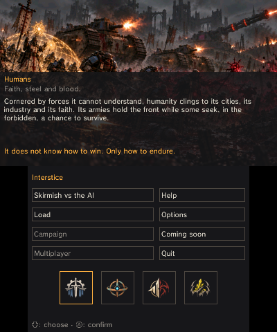
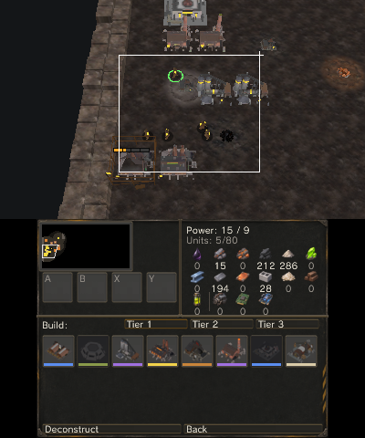
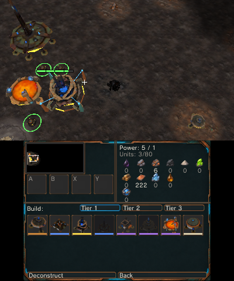
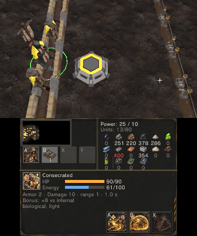
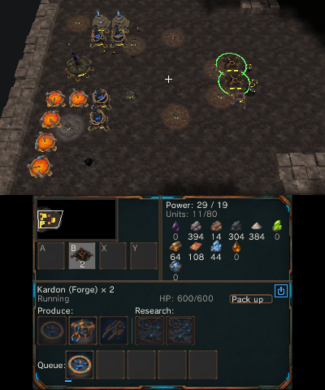

# Interstice

**A grimdark real-time strategy game for the New Nintendo 3DS XL** (homebrew, unofficial). Factory-style production chains without conveyor belts, two very different factions, 80 units per side, 3D battlefield on the top screen and a full command interface on the touch screen.

*Un jeu de stratégie en temps réel grimdark pour New 3DS XL (homebrew, non officiel). Chaînes de production sans tapis, deux factions très différentes, 80 unités par camp, bataille en 3D sur l'écran du haut et interface complète au stylet sur l'écran du bas.*

> 🎮 **Optimized for the New 3DS / New 3DS XL**: the game uses the 804 MHz mode and the second CPU core. An Old 3DS is untested and not supported.
>
> *Optimisé pour la New 3DS / New 3DS XL : le jeu utilise le mode 804 MHz et le second cœur. L'Old 3DS n'est ni testée ni prise en charge.*

> ⚠️ **Mature content / Contenu pour adultes** : the game shows blood, dismembered bodies and brutal deaths. *Le jeu montre du sang, des corps démembrés et des morts brutales.*

## Current version: demo / Version actuelle : démo

- **Skirmish against the AI**: Humans or Vel Kethra, three difficulty levels, English and French.
- **Humans**: trenches, a classic industrial chain, the Reliquary. **Vel Kethra**: machines, mobile buildings (pack up / deploy), unit fusion.
- Save and load, in-game manual (Help), music per faction.
- Coming later: two more factions (The Cloven Seal, Hl'aasth), more maps, campaigns, local multiplayer.

## Install / Installation

**Requirements**: a New 3DS (XL) with custom firmware, the [FBI](https://github.com/Steveice10/FBI) installer, and the DSP firmware dump (`sdmc:/3ds/dspfirm.cdc`) for sound. The game is built for the New 3DS (804 MHz mode, second core, extra memory); an Old 3DS is untested and not supported.

1. Download `interstice.cia` from the [latest release](../../releases/latest).
2. Copy it to your SD card (for example in `/cias/`), open FBI → *SD* → the file → *Install*.
   *Or*: in FBI choose *Remote Install* → *Scan QR code* and scan the QR code on the release page.
3. Launch **Interstice** from the HOME Menu. A `.3dsx` is also provided for the Homebrew Launcher.

*Copiez le `.cia` sur la carte SD, installez-le avec FBI (ou par QR code), puis lancez le jeu depuis le menu HOME. jeu optimisé pour la New 3DS ; Old 3DS non testée.*

## Controls / Commandes

| | |
|---|---|
| C-Stick | move the cursor / *curseur* |
| L | select (hold and drag: box; twice: all units of that type) |
| R | order depending on the target / *ordre selon la cible* |
| ZL + R | attack-move / *avance offensive* |
| D-pad down + R | queue the order / *file d'ordres* |
| A / B / X / Y | abilities / *capacités* |
| D-pad up + A/B/X/Y | control groups / *groupes* |
| Circle Pad | scroll the map / *défilement* |
| SELECT + Circle Pad up/down | zoom |
| START | pause menu / *menu pause* |

Everything else is explained in the in-game manual (Help) and with tooltips on the touch screen.

## Screenshots

| | |
|---|---|
|  |  |
|  |  |

## Feedback / Avis

- Bug or crash: open an [issue](../../issues/new/choose) (attach the log from `sdmc:/3ds/interstice/logs/` if you can).
- Quick anonymous feedback (2 minutes, no account): [feedback form](https://tally.so/r/7XKBJz).
- Ideas and impressions: [Discussions](../../discussions) or an issue "Feedback".

## License / Licence

Free, non-commercial, unofficial homebrew game, released under [**CC BY-NC-ND 4.0**](LICENSE): you may share the unmodified game with credit, but not sell it or distribute modified versions. This repository contains the releases only; the source code is closed. Third-party credits: [CREDITS.md](CREDITS.md).

*Jeu homebrew gratuit, non commercial et non officiel, sous licence CC BY-NC-ND 4.0 : partage libre sans modification et avec mention de l'auteur, ni vente ni version modifiée. Ce dépôt ne contient que les releases ; le code est fermé.*

By **gReeD034**. Made with the help of AI tools (Claude, ChatGPT, Meshy), see [CREDITS.md](CREDITS.md). Not affiliated with or endorsed by Nintendo or any other company.
